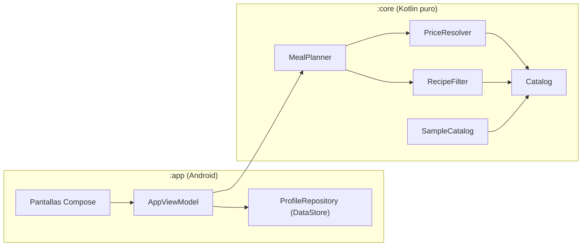
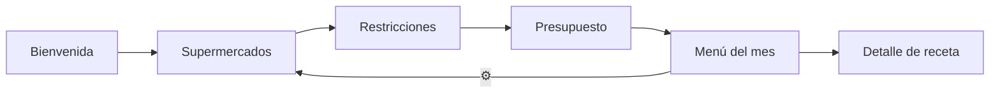
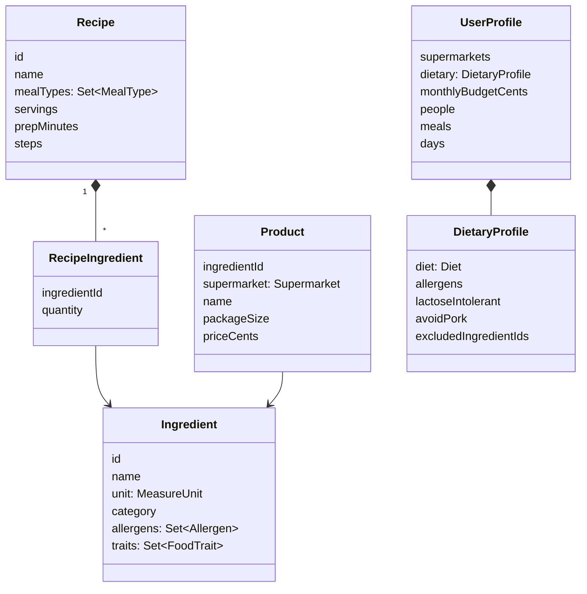

# Arquitectura

## Módulos

El proyecto Gradle tiene dos módulos:

- **`:core`** — biblioteca Kotlin/JVM pura. Contiene el modelo de dominio, el catálogo de ejemplo y
  el algoritmo de planificación. No depende de Android, por lo que se prueba con tests JUnit normales
  y podría reutilizarse (p. ej., en un backend).
- **`:app`** — aplicación Android. Depende de `:core` y contiene la interfaz (Jetpack Compose), el
  `ViewModel` y la persistencia local.

## Patrón de la interfaz

Se sigue el patrón **MVVM** recomendado por Google con flujo de datos unidireccional:

- Las pantallas son funciones `@Composable` sin estado propio relevante: reciben datos y emiten eventos.
- `AppViewModel` expone `StateFlow` (`draft`, `planState`, `minimumEstimate`, …) y métodos de acción
  (`updateDraft`, `confirmProfile`, `regenerate`, `toggleBought`).
- El cálculo del menú se ejecuta en `Dispatchers.Default` para no bloquear la interfaz.
- Solo se guarda el **perfil** y la **semilla** del generador aleatorio: como el algoritmo es
  determinista para una semilla dada, el mismo menú se reconstruye al abrir la app sin necesidad de
  guardarlo entero.

### Navegación

## Modelo de datos

Decisiones relevantes:

- **Precios en céntimos (`Int`)** para evitar errores de redondeo con decimales.
- **Unidad base por ingrediente** (gramos, mililitros o unidades). Recetas y envases usan la misma unidad.
- **Alérgenos y rasgos** se definen en el ingrediente; los de la receta se derivan, así no pueden
  quedar desincronizados.
- **Dieta como conjunto de rasgos prohibidos**: `VEGAN` prohíbe carne, pescado, marisco, lácteos,
  huevo y miel; añadir una nueva dieta es solo añadir un valor al `enum`.

## Persistencia

`ProfileRepository` usa **Jetpack DataStore (Preferences)**. Para la siguiente fase, cuando haya
precios reales descargados, se propone **Room** (SQLite) para cachear el catálogo localmente.
