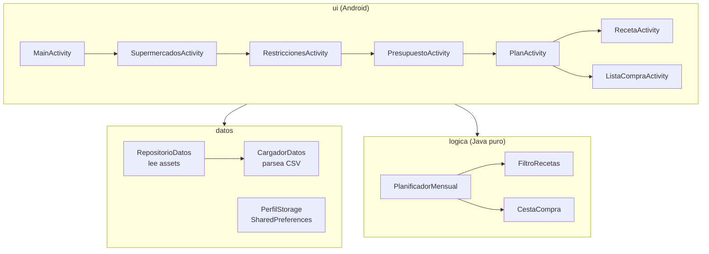
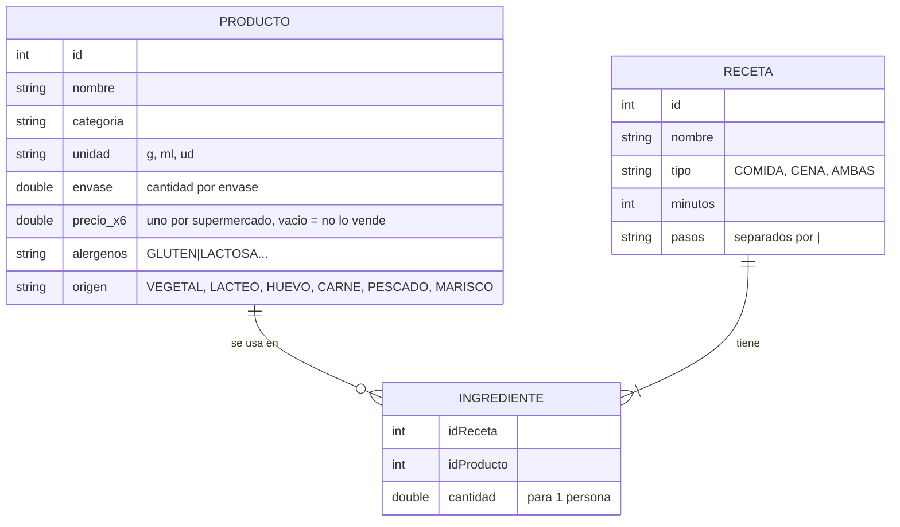

# 03 · Diseño

## 1. Arquitectura

La app está separada en capas para que la parte "lista" (el cálculo del plan) no dependa de Android y se pueda probar con JUnit en el ordenador.



| Paquete | Qué hace | ¿Usa Android? |
|---|---|---|
| `modelo` | Clases de datos: `Producto`, `Receta`, `Ingrediente`, `PerfilUsuario`, `PlanMensual`, `DiaPlan`, `LineaCompra` y los enums `Supermercado`, `Restriccion`, `Momento`. | No |
| `datos` | `CargadorDatos` parsea los CSV; `RepositorioDatos` los abre desde `assets`; `PerfilStorage` guarda el perfil. | Solo los dos últimos |
| `logica` | Filtro de recetas, cálculo del coste y planificador. | No |
| `ui` | Activities, adaptador y formato de euros/cantidades. | Sí |

**Persistencia:** el perfil se guarda en `SharedPreferences` (son pocos datos). El plan **no se guarda**: se recalcula al abrir la pantalla porque tarda milisegundos. Para que no cambie cada vez, el azar usa una **semilla** guardada en el perfil; el botón *Otro plan* simplemente suma 1 a la semilla.

## 2. Modelo de datos

Los datos están en tres CSV (separador `;`) dentro de `app/src/main/assets`:



Decisiones:

- **Las restricciones se calculan a partir de los productos**, no se escriben a mano en cada receta. Si una receta lleva pan rallado (GLUTEN), ya no aparece a un celíaco. Así es imposible equivocarse al etiquetar recetas.
- **Vegetariano/vegano** se deduce del campo `origen` del producto (vegano = todo VEGETAL; vegetariano = sin CARNE, PESCADO ni MARISCO).
- **Las cantidades son por persona** y se multiplican por el número de personas del perfil.

## 3. Cálculo del coste: envases, no gramos

En el supermercado no se compran 80 g de arroz, se compra un paquete de 1 kg. Por eso `CestaCompra` acumula la cantidad total de cada producto en el mes y calcula:

```
envases = techo(cantidad total / cantidad por envase)
coste   = envases × precio del envase en el supermercado más barato de los elegidos
```

Ejemplo con arroz (1 kg a 1,15 € en Lidl) y una receta que usa 80 g:

| Vez que se cocina | Arroz acumulado | Envases | Coste extra |
|---|---|---|---|
| 1ª | 80 g | 1 | 1,15 € |
| 2ª | 160 g | 1 | 0,00 € |
| ... | ... | 1 | 0,00 € |
| 13ª | 1040 g | 2 | 1,15 € |

Esto hace que el planificador **aproveche lo que ya se ha comprado**, que es como se ahorra en la vida real.

## 4. Algoritmo del planificador

`PlanificadorMensual.generar(perfil, recetas)` es un algoritmo **voraz** (en cada paso elige la mejor opción en ese momento) con dos pasadas:

1. **Filtrar** recetas válidas (restricciones + supermercados) y separarlas en candidatas de comida y de cena.
2. **Pasada "ahorro"**: rellena los 30 días eligiendo siempre la receta que menos sube el gasto. El resultado es el **coste mínimo aproximado** del mes.
   - Si el coste mínimo supera el presupuesto, se genera el plan hasta donde llega el dinero y se avisa: *"Con X € no llega para todo el mes. Necesitarías unos Y €"*.
3. **Pasada normal** (si hay dinero suficiente): para cada hueco (día + comida/cena) calcula una puntuación por receta y elige la menor:

```
puntuación = coste extra
           + veces usada × margen × 0,6        (variedad)
           + recencia × margen × 3              (no repetir lo de hace poco)
           + azar(0..1) × margen                (planes distintos al pulsar "Otro plan")

margen   = dinero que queda / huecos que quedan
recencia = 1 / (días desde la última vez + 1)
```

Normas fijas:

- No se repite la receta del día anterior en el mismo momento, ni la misma receta en comida y cena del mismo día.
- Cada receta tiene un máximo de usos al mes.
- Antes de elegir, se comprueba que con lo gastado + el coste extra **queda dinero reservado** para los huecos que faltan (según el coste mínimo de la pasada 1). Así el plan nunca se queda sin dinero a final de mes.

La idea del `margen` es que **cuanto más dinero sobra, más pesa la variedad**; con un presupuesto justo, el coste manda y el plan es más repetitivo pero llega.

## 5. Pruebas

`PlanificadorMensualTest` comprueba, leyendo los CSV reales:

- Que se cargan todas las recetas y ninguna está vacía.
- Que **nunca se pasa del presupuesto** (5 presupuestos × 1 a 4 personas).
- Que con presupuesto holgado el plan tiene los 30 días completos.
- Que con presupuesto corto avisa y da el mínimo necesario.
- Que un vegano solo recibe ingredientes vegetales y un celíaco nada con gluten.
- Que la lista de la compra suma lo mismo que el coste y solo usa los supermercados elegidos.
- Que si tiene básicos en casa no se le cobran.

## 6. Limitaciones conocidas

- Los precios son **aproximados** y se actualizan a mano en el CSV.
- La "compra más barata" es por producto: no tiene en cuenta que ir a varios supermercados cuesta tiempo.
- No hay valoración nutricional; la variedad se consigue repitiendo poco las recetas.
